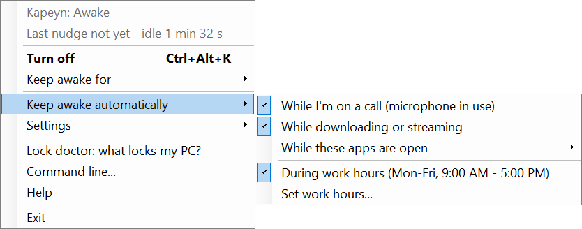
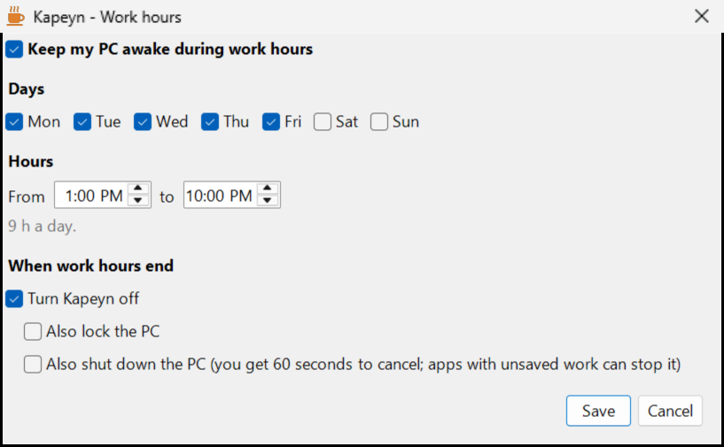
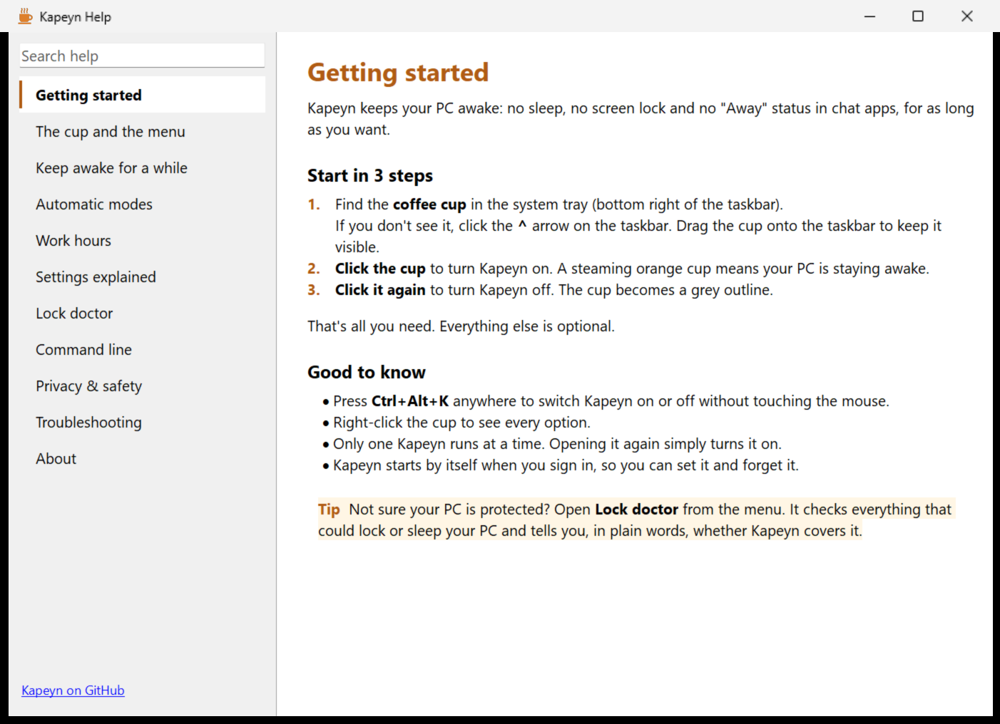
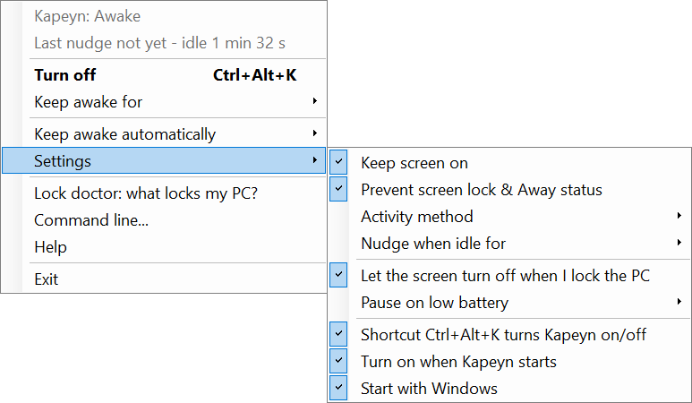
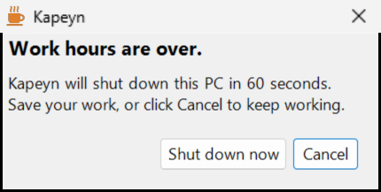
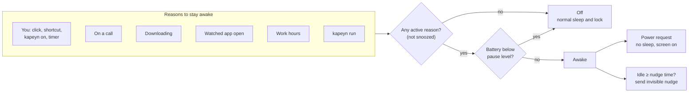

<div align="center">


# Kapeyn

**Keep your computer awake, intelligently.**<br>
A tiny tray / menu bar app for Windows and macOS that stops sleep, screen lock and "Away" status only when you need it.

[](https://github.com/jvbalcita/kapeyn/actions/workflows/release.yml)
[](https://github.com/jvbalcita/kapeyn/releases/latest)
[](LICENSE)


[**Download**](https://github.com/jvbalcita/kapeyn/releases/latest) ·
[Quick start](#quick-start) ·
[Features](#features) ·
[Command line](#command-line) ·
[Troubleshooting](#troubleshooting)

</div>

---

## Table of contents

- [Why Kapeyn](#why-kapeyn)
- [Features](#features)
- [Screenshots](#screenshots)
- [Install](#install)
- [Quick start](#quick-start)
- [Using Kapeyn](#using-kapeyn)
  - [The cup and the menu](#the-cup-and-the-menu)
  - [Automatic modes](#automatic-modes)
  - [Work hours](#work-hours)
  - [Lock doctor](#lock-doctor)
  - [Built-in help](#built-in-help)
- [Command line](#command-line)
- [How it works](#how-it-works)
- [Privacy and security](#privacy-and-security)
- [Configuration reference](#configuration-reference)
- [Troubleshooting](#troubleshooting)
- [Build from source](#build-from-source)
- [Project structure](#project-structure)
- [Releasing](#releasing)
- [Contributing](#contributing)
- [Responsible use](#responsible-use)
- [License](#license)

---

## Why Kapeyn

Many work computers lock after a few minutes **without keyboard or mouse input**, whatever power settings say, and chat apps mark you "Away" at the same time. Most keep-awake tools only send a *power request*, which stops sleep but not that input-based lock. Others simulate a key press that some setups ignore.

Kapeyn combines both, and adds judgement:

- 🔌 A **power request** stops sleep and screen-off.
- 🖱️ An **invisible nudge**, sent only while you're idle, resets the idle timer behind company screen-lock policies and Teams/Slack "Away".
- 🩺 A **Lock doctor** reads your machine's real lock timers, including ones set by IT, and picks the nudge timing for you.
- 🤖 **Automatic modes** keep you awake on calls, during downloads, while chosen apps are open, or during work hours, and stop when they're over.

The result: one small app, no admin rights, and no more "did my screen lock again?" moments.

## Features

| | Feature | What it does |
|---|---|---|
| ☕ | **One-click on/off** | Click the cup or press **Ctrl+Alt+K** (Windows) / **⌃⌥K** (Mac). Hover to see *why* it's awake. |
| ⏱️ | **Timed sessions** | Keep awake for 15 min to 8 h, then switch off by itself. |
| 📞 | **While on a call** | Stays awake whenever any app uses the microphone (Teams, Zoom, Meet, Slack…). |
| ⬇️ | **While downloading** | Stays awake during sustained downloads or streams. Short background syncs are ignored. |
| 🪟 | **While apps are open** | Pick apps (video editor, remote desktop, VM…) that keep the computer awake. |
| 🗓️ | **Work hours** | Days plus any start/end time, overnight shifts included. At the end it can turn off, **lock** or **shut down** (60 s to cancel). |
| 🩺 | **Lock doctor** | Lists every lock/sleep timer, flags ones **set by your organization**, checks coverage, self-tests, and gives a verdict. |
| ⚙️ | **Auto timing** | Nudges at half the shortest lock timer (30 s – 4 min), so it's never too late. |
| 💻 | **`kapeyn` command** | `kapeyn on 2h`, `kapeyn run npm run build`, `kapeyn doctor`, `kapeyn status`… |
| 🔋 | **Knows when to stop** | Pauses on low battery, lets the screen sleep when *you* lock it, and respects "off" until a call or download ends. |
| 📖 | **Built-in Help** | A searchable guide inside the app that covers every feature step by step. |
| 🔒 | **Private by design** | No internet, no telemetry, no admin rights. One file on Windows (~100 KB). |

## Screenshots

<table>
  <tr>
    <td width="50%" valign="top"><br><sub><b>Tray menu</b>: status, automatic modes and work hours.</sub></td>
    <td width="50%" valign="top"><br><sub><b>Work hours</b>: any times, overnight shifts, and what happens at the end.</sub></td>
  </tr>
  <tr>
    <td width="50%" valign="top"><br><sub><b>Built-in Help</b>: searchable, step-by-step guide.</sub></td>
    <td width="50%" valign="top"><br><sub><b>Settings</b>: on Windows the menu stays open while you change things.</sub><br><br><br><sub><b>End-of-day shutdown</b>: optional, with a 60-second countdown.</sub></td>
  </tr>
</table>

<sub>Screenshots are from Windows. The macOS version has the same features in the menu bar.</sub>

## Install

Get the latest version from the **[Releases page](https://github.com/jvbalcita/kapeyn/releases/latest)**.

| Download | For | What's inside |
|---|---|---|
| `Kapeyn.exe` | Windows 10/11 | The app. Double-click and go, no install needed. |
| `Kapeyn-Windows.zip` | Windows 10/11 | The app, the `kapeyn` command and an installer. **Recommended.** |
| `Kapeyn-macOS.zip` | macOS 12+ (Apple silicon & Intel) | `Kapeyn.app` |

### Windows

1. Download and unzip **`Kapeyn-Windows.zip`**.
2. Right-click **`install.ps1`** and choose **Run with PowerShell**, or run:

   ```powershell
   powershell -ExecutionPolicy Bypass -File .\install.ps1
   ```

The installer:
- copies Kapeyn to `%LOCALAPPDATA%\Programs\Kapeyn`
- adds the `kapeyn` command to your PATH
- creates a Start menu shortcut
- starts Kapeyn at sign-in, and starts it now

No admin rights are needed. To uninstall, run `install.ps1 -Uninstall`.

> [!NOTE]
> Kapeyn isn't code-signed yet, so the first run may show **"Windows protected your PC"**. Click **More info → Run anyway**.

### macOS

**Option A: download (quickest).** Unzip **`Kapeyn-macOS.zip`** and drag **Kapeyn** to Applications. On first launch macOS blocks it because it isn't notarized yet. Open **System Settings → Privacy & Security** and click **Open Anyway**, or run:

```bash
xattr -dr com.apple.quarantine /Applications/Kapeyn.app
```

**Option B: build it on your Mac (no warnings).**

```bash
git clone https://github.com/jvbalcita/kapeyn.git
cd kapeyn/mac
bash install.sh
```

This needs Apple's free Command Line Tools; if they're missing, run `xcode-select --install` first. The installer builds `Kapeyn.app`, copies it to `~/Applications`, starts it at login, and adds the `kapeyn` command when it can. To uninstall, run `bash install.sh --uninstall`.

## Quick start

1. Find the **coffee cup** in the system tray (Windows; click **^** if hidden) or the menu bar (Mac).
2. **Click it.** A steaming orange cup means your computer is staying awake.
3. **Click it again** to stop. That's it.

Then, optionally:

- **Right-click** the cup → **Lock doctor** to confirm everything is covered.
- **Right-click** → **Keep awake automatically** to let Kapeyn handle calls, downloads and work hours for you.
- **Right-click** → **Help** for the full guide.

## Using Kapeyn

### The cup and the menu

| Cup | Meaning |
|---|---|
| Steaming orange cup | **Awake.** No sleep, dimming or lock. Hover to see why ("on a call", "1 h 20 min left", "work hours"…). |
| Grey outline | **Off.** Normal sleep and lock settings apply. |

Right-click the cup (Control-click on a Mac) to open the menu:

| Menu item | Purpose |
|---|---|
| **Status** | What Kapeyn is doing, and when it last nudged. |
| **Turn on / off** | Same as clicking the cup or pressing the shortcut. |
| **Keep awake for** | 15 min, 30 min, 1 h, 2 h, 4 h or 8 h, then off automatically. |
| **Keep awake automatically** | Calls, downloads, chosen apps, work hours. |
| **Settings** | Screen, lock prevention, nudge method and timing, battery, shortcut, startup. |
| **Lock doctor** | Diagnose what could lock or sleep the computer. |
| **Command line…** | How to use the `kapeyn` command. |
| **Help** | The built-in guide. |

### Automatic modes

| Mode | Turns on when… | Default |
|---|---|---|
| **On a call** | Any app is using a microphone. | On |
| **Downloading or streaming** | Sustained incoming traffic (~150 KB/s for about 15 s), plus one minute after it stops. | On |
| **Apps are open** | One of your chosen apps is running (*While these apps are open → Add an open app*). | None chosen |
| **Work hours** | Inside your schedule. | Off |
| **`kapeyn run`** | The wrapped command is running. | n/a |

If you turn Kapeyn **off** during an automatic mode, it stays off until that call or download ends. The next one turns it back on.

### Work hours

**Keep awake automatically → Set work hours…** opens one window for everything:

- **Days:** any combination.
- **Hours:** any start and end time to the minute. If the end is earlier than the start, the hours run **overnight** (e.g. 10 PM – 6 AM). A night shift belongs to the day it starts.
- **When work hours end:**
  - **Turn Kapeyn off** (default on): stops a manual "on" from running all night.
  - **Also lock** the computer (default off).
  - **Also shut down** (default off): a 60-second countdown with **Cancel**, then a normal shutdown. Apps with unsaved work can still stop it.

> [!IMPORTANT]
> Lock and shutdown only fire when the end of work hours passes **while the computer is on**. They never fire when the computer wakes from sleep after the end time, when you save new hours, or when you switch the schedule off.

### Lock doctor

**Right-click → Lock doctor** (or `kapeyn doctor`) produces a plain-language report like this one (example output):

```text
Timers on this PC that can lock it, blank the screen or put it to sleep:

  * Windows locks after no keyboard/mouse input: after 5 min   [set by your organization]
      [OK] Covered: Kapeyn nudges after 2 min 30 s of idle.

  * Display turns off (plugged in), then sign-in is required: after 10 min
      [OK] Covered: Kapeyn keeps the display on.

Kapeyn right now:
  * Status: Awake
  * Windows sees a keep-awake request: yes (PC stays awake, display stays on)
  * Self-test: Windows accepted 2 of 2 simulated inputs [OK]

Verdict:
  [OK] Kapeyn covers every timer found on this PC.
```

| Platform | What it checks |
|---|---|
| **Windows** | Machine inactivity limit (Group Policy), screen saver (+ password), display-off and sleep timers from the active power plan (including policy overrides). |
| **macOS** | Screen saver idle time (including MDM-managed profiles), password-after-sleep delay, display sleep and system sleep (`pmset`). |

The same findings drive **Auto** nudge timing: half of the shortest input-based timer, clamped to 30 s – 4 min. That stays under Teams' 5-minute "Away" threshold.

### Built-in help

**Right-click → Help** (or `kapeyn guide`) opens a searchable guide with step-by-step instructions for every feature:
- Getting started and the menu
- Timed sessions and automatic modes
- Work hours and every setting
- Lock doctor and the command line
- Privacy, troubleshooting and About

Windows and macOS read the same source, [`help/help.md`](help/help.md), so the guide is always in sync with the app.

## Command line

The `kapeyn` command controls the running app, and starts it if needed.

| Command | Description |
|---|---|
| `kapeyn` | Show status. |
| `kapeyn on` | Keep awake until turned off. |
| `kapeyn on <duration>` | Keep awake for a while: `45m`, `2h`, `1h30m` or plain minutes (`90`). |
| `kapeyn off` | Turn off. |
| `kapeyn toggle` | Switch on/off. |
| `kapeyn run <command…>` | Keep awake **exactly** while a command runs, then return its exit code. |
| `kapeyn doctor` | Run the Lock doctor and print the report. |
| `kapeyn guide` | Open the built-in Help window. |
| `kapeyn help` | List commands. |

```console
$ kapeyn on 1h30m
Kapeyn: Awake - 1 h 30 min left

$ kapeyn run npm run build        # stays awake for the whole build, then hands back npm's exit code
$ kapeyn run -- robocopy C:\src D:\backup /MIR

$ kapeyn status
Kapeyn: Awake - on a call (Teams), work hours
  Last nudge 40 s ago - idle 2 min 10 s
  Keep screen on: yes | Prevent screen lock: yes, nudge after 2 min 30 s idle (auto)
  Automatic: calls yes | downloads yes | work hours Mon-Fri, 9:00 AM - 5:00 PM
```

<details>
<summary><b>Where the command comes from</b></summary>

- **Windows:** `kapeyn.com` sits next to `Kapeyn.exe`. Windows runs `.com` before `.exe`, so typing `kapeyn` gets the command-line tool, while double-clicking `Kapeyn.exe` opens the tray app. `install.ps1` adds the folder to your user PATH.
- **macOS:** the app's own binary acts as the command when given a command word. `install.sh` links it to `/usr/local/bin/kapeyn` when that folder is writable. Otherwise use **Command line… → Install command** in the menu, which asks for your password once.
- `kapeyn run` uses `cmd /c` on Windows (so `.cmd` shims like `npm` work) and `/usr/bin/env` on macOS. If the app can't be reached, the command keeps the computer awake itself.

</details>

## How it works



Kapeyn re-evaluates every 5 seconds, and immediately on wake, lock/unlock and settings changes.

| | Windows | macOS |
|---|---|---|
| Stop sleep / screen-off | `SetThreadExecutionState` | IOKit power assertion (`PreventUserIdleDisplaySleep` / `…SystemSleep`) |
| Nudge while idle | `SendInput`: 1 px mouse move and back (cursor restored) and/or F15 | `IOPMAssertionDeclareUserActivity`; optional 1 px mouse move (needs Accessibility) |
| Idle time | `GetLastInputInfo` | `CGEventSource` |
| On a call | Windows' microphone-privacy records (`CapabilityAccessManager`) | CoreAudio "device is running somewhere" on input devices |
| Downloads | Network adapter byte counters | `getifaddrs` interface counters |
| Global shortcut | `RegisterHotKey` | Carbon `RegisterEventHotKey` (no permission needed) |
| App ↔ command | Per-user named pipe | Local Mach message port |
| Start at login | `HKCU\…\Run` | `~/Library/LaunchAgents` |

## Privacy and security

- **Offline.** Kapeyn makes no network connections and has no telemetry or analytics.
- **Local only.** Settings live on your computer (see [Configuration reference](#configuration-reference)).
- **Least privilege.** No admin rights, no services, no drivers. It runs as you.
- **Minimal sensing.** It checks *whether* a microphone is in use (never audio), *how much* data arrives (never contents), and *which* apps are open, and only for modes you enabled.
- **No surprises.** It never locks or shuts down unless you turned that on, and shutdown always shows a cancelable countdown.
- **Auditable.** All source code is in this repository, and releases are built from it by GitHub Actions.

## Configuration reference

Settings change through the menu. You rarely need to edit them by hand.

<details>
<summary><b>Windows: <code>%APPDATA%\Kapeyn\settings.ini</code></b></summary>

| Key | Default | Meaning |
|---|---|---|
| `StartActive` | `True` | Turn on when Kapeyn starts. |
| `KeepScreenOn` | `True` | Keep the display on while awake. |
| `SimulateActivity` | `True` | Nudge while idle (prevents lock / Away). |
| `NudgeMethod` | `Mouse` | `Mouse`, `Keyboard` (F15) or `Both`. |
| `NudgeSeconds` | `0` | `0` = Auto, or 10–3600 seconds. |
| `WhileCall` | `True` | Awake while a microphone is in use. |
| `WhileDownloading` | `True` | Awake during sustained downloads. |
| `WatchApps` | *(empty)* | Watched apps: `process\|Label` entries separated by `;` |
| `ScheduleEnabled` | `False` | Work hours on/off. |
| `ScheduleDays` | `62` | Bitmask, Sunday = 1, Monday = 2 … Saturday = 64 (62 = Mon–Fri). |
| `ScheduleStartMin` | `540` | Start, in minutes after midnight (540 = 9:00 AM). |
| `ScheduleEndMin` | `1020` | End; earlier than start = overnight. |
| `ScheduleEndTurnsOff` | `True` | Turn Kapeyn off when work hours end. |
| `EndLock` | `False` | Also lock at the end of work hours. |
| `EndShutdown` | `False` | Also shut down (with countdown). |
| `ScreenOffWhenLocked` | `True` | Let the screen sleep when you lock the PC. |
| `PauseBatteryPercent` | `20` | Pause below this battery level; `0` = never. |
| `Hotkey` | `True` | Ctrl+Alt+K toggles Kapeyn. |

</details>

<details>
<summary><b>macOS: <code>defaults read com.kapeyn.Kapeyn</code></b></summary>

The same keys and defaults as Windows, except `WiggleMouse` (default `false`, needs Accessibility) replaces `NudgeMethod`, and `WatchApps` is a list of `{id, name}` bundle IDs. Example:

```bash
defaults write com.kapeyn.Kapeyn PauseBatteryPercent -int 30   # then restart Kapeyn
```

</details>

## Troubleshooting

<details>
<summary><b>My screen still locks</b></summary>

1. Run **Lock doctor**; it usually names the exact cause.
2. Check **Settings → Prevent screen lock & Away status** is ticked.
3. Set **Settings → Nudge when idle for → Auto**.
4. Windows: try **Settings → Activity method → Both**. Mac: turn on **Also nudge the mouse** and allow it under **Privacy & Security → Accessibility**.

</details>

<details>
<summary><b>Teams or Slack still show me as Away</b></summary>

Chat apps watch real keyboard/mouse activity. On Windows, use **Activity method → Mouse wiggle** or **Both**. On a Mac, turn on **Also nudge the mouse (Teams/Slack)**. The Mac Lock doctor's self-test tells you whether you need it.

</details>

<details>
<summary><b>I can't find the cup</b></summary>

- **Windows:** click **^** on the taskbar, and drag the cup onto the taskbar to pin it. Or open **Kapeyn** from the Start menu.
- **Mac:** the menu bar may be full (notch). Quit some menu bar apps, or ⌘-drag the cup left.

</details>

<details>
<summary><b>Kapeyn is awake when I didn't ask, or turned itself off</b></summary>

Hover over the cup; it always says why. Common reasons:
- **Awake:** an automatic mode (call, download, app, work hours).
- **Off:** a timer ended, work hours ended, or it paused on low battery. Click the cup to override the battery pause.

</details>

<details>
<summary><b>"kapeyn" is not recognized / command not found</b></summary>

- **Windows:** open a *new* terminal after installing, or run `install.ps1` from `Kapeyn-Windows.zip` again.
- **Mac:** use **Command line… → Install command** in the menu, then open a new Terminal window.
- "Kapeyn is running but didn't answer": an older version is running. Exit it from the tray and try again.

</details>

<details>
<summary><b>A MacBook sleeps when I close the lid</b></summary>

That's a macOS rule no app can override, unless the Mac is on power with an external display.

</details>

## Build from source

<details open>
<summary><b>Windows</b> (no SDK needed)</summary>

```powershell
powershell -ExecutionPolicy Bypass -File .\build.ps1
```

This uses the C# compiler that ships with Windows (.NET Framework 4.x) and writes `dist\Kapeyn.exe` (the app) and `dist\kapeyn.com` (the command), with the icon, manifest and Help guide embedded.

</details>

<details open>
<summary><b>macOS</b> (Xcode Command Line Tools)</summary>

```bash
bash mac/build.sh
```

This builds a universal `mac/dist/Kapeyn.app` (Apple silicon + Intel), ad-hoc signed, with the icon and Help guide bundled.

</details>

## Project structure

```text
kapeyn/
├── src/                    Windows app (C#, .NET Framework 4.x)
│   ├── Program.cs          entry point; tray app or CLI build
│   ├── TrayApp.cs          engine (reasons → awake), tray icon and menu
│   ├── Triggers.cs         work hours, calls, downloads, watched apps, battery
│   ├── Doctor.cs           Lock doctor and report window
│   ├── WorkHours.cs        work hours window and shutdown countdown
│   ├── Help.cs             built-in Help window
│   ├── Cli.cs / Ipc.cs     kapeyn command and named-pipe link to the app
│   └── Native.cs …         Win32 calls, settings, icon drawing
├── mac/
│   ├── src/                macOS app (Swift, AppKit), same structure
│   ├── build.sh            builds the universal Kapeyn.app
│   └── install.sh          installs for the current user
├── help/help.md            the in-app guide (shared by both apps)
├── docs/images/            README images
├── build.ps1 / install.ps1 Windows build and install scripts
├── LICENSE                 MIT License
└── .github/workflows/      CI: build both apps on every push and PR; publish releases on tags
```

## Releasing

Every push to `main` and every pull request builds both apps in GitHub Actions. The Mac app is also launched and smoke-tested through the `kapeyn` command. To publish a release:

```bash
git tag v2.2.0
git push origin v2.2.0
```

The workflow attaches `Kapeyn.exe`, `Kapeyn-Windows.zip` and `Kapeyn-macOS.zip` to a new GitHub Release. Remember to bump the version in `src/Program.cs` and `mac/build.sh` first.

## Contributing

Issues and pull requests are welcome. By contributing, you agree that your contributions are licensed under the [MIT License](LICENSE).

1. Branch from `main`.
2. Keep Windows and macOS behaviour in step. A feature usually touches `src/` and `mac/src/`, plus `help/help.md` and this README.
3. Run `build.ps1` and/or `mac/build.sh` locally. CI must be green before merging.
4. Write help text in plain, friendly language. Use `[win] ` / `[mac] ` line prefixes for platform-specific lines.

## Responsible use

Screen-lock timers on work computers are often a security control. Kapeyn is meant to keep your machine usable during calls, presentations, downloads and long tasks, not to leave an unlocked computer unattended. Lock your screen when you step away (or let **Work hours** lock it for you), and follow your organization's policies.

## License

Kapeyn is free and open source under the [MIT License](LICENSE). You can use, copy, modify and distribute it, including commercially, as long as you keep the copyright notice. It comes with no warranty.

---

<div align="center"><sub>Made with ☕</sub></div>
